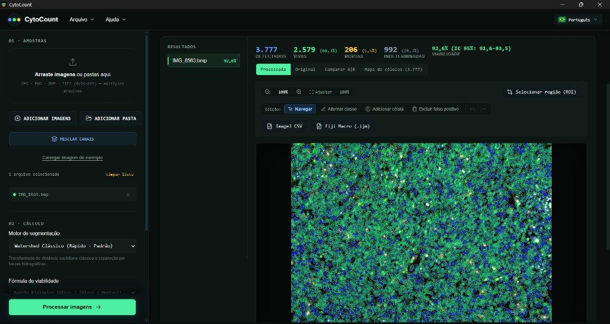

<a name="top"></a>
<p align="center">
  <a href="https://github.com/gcandid0/CytoCount">
    
  </a>
</p>

<div align="center">

# CytoCount

### High-precision scientific desktop platform for automated cell viability quantification and morphological segmentation via multi-channel fluorescence microscopy.

<sub><a href="./README.md">🇧🇷 Português</a> &nbsp;|&nbsp; 🇺🇸 English &nbsp;|&nbsp; <a href="./README.es.md">🇪🇸 Español</a></sub>

<br/>

<a href="https://doi.org/10.5281/zenodo.24224692"></a>
<a href="https://gcandid0.github.io/CytoCount"></a>
<a href="https://tauri.app/"></a>
<a href="https://www.python.org/"></a>
<a href="https://react.dev/"></a>
<a href="https://github.com/stardist/stardist"></a>
<a href="./LICENSE"></a>

<br/>

<a href="https://github.com/gcandid0/CytoCount/stargazers"></a>
<a href="https://github.com/gcandid0/CytoCount/commits/main"></a>
<a href="https://github.com/gcandid0/CytoCount"></a>
<a href="https://github.com/gcandid0/CytoCount/issues"></a>

<br/><br/>

<a href="http://lattes.cnpq.br/6696786236047929"></a>
<a href="https://www.linkedin.com/in/gabriel-candido-235637226/"></a>
<a href="https://github.com/gcandid0/CytoCount"></a>

</div>

<p align="center"><sub>Developed by <strong>Gabriel Candido Messias dos Santos</strong> · Campinas - SP, Brazil</sub></p>

## Table of Contents

- [About CytoCount](#about-cytocount)
- [Languages](#languages)
- [Supported Fluorophores and Channels](#supported-fluorophores-and-channels)
- [Getting Started](#getting-started)
- [Features](#features)
- [Segmentation Engines](#segmentation-engines)
- [Tech Stack](#tech-stack)
- [Roadmap](#roadmap)
- [Contact](#contact)
- [Authors](#authors)
- [License](#license)
- [How to Cite](#how-to-cite)
- [Contributing](#contributing)

---

> 🌐 **Live Demo & Online Downloads:** Visit [**https://gcandid0.github.io/CytoCount**](https://gcandid0.github.io/CytoCount) to explore interactive animated GIF demos, curtain comparisons, and direct Windows installer downloads (NSIS .exe, MSI, and Portable ZIP).

## About CytoCount

**CytoCount** is high-performance scientific software engineered for **automated cell viability quantification** and **morphological segmentation** in multi-channel fluorescence microscopy.

Built on a modern hybrid architecture combining **Rust (Tauri v2)** for the native desktop client and **Python (FastAPI, OpenCV, SciPy, scikit-image)** running as an isolated local computational *sidecar*, CytoCount processes everything 100% offline, guaranteeing strict privacy and data protection for sensitive laboratory samples.

**Key Features:**

- **Single Source of Truth & 95% Wilson CI** - `Detected = Live + Dead + Indeterminate` with exact binomial statistical confidence intervals.
- **Hybrid Segmentation Engines** - toggle seamlessly between *Classic Watershed* (Euclidean distance transform), *StarDist 2D* (star-convex polygons), and *Cellpose 2D* (topological vector field flows).
- **Morphological Cytoplasm Delimitation** - continuous geodesic Voronoi cell partitioning for accurate cytoplasm area estimation without encroaching on neighboring cells.
- **Interactive Manual Curation** - on-canvas tools to switch cell classes, add missed cells, or eliminate debris/false positives, with full `Ctrl+Z` (Undo) and `Ctrl+Y` (Redo) history.
- **Multi-channel Merge & 16-bit TIFF** - native support for separate monochromatic channels (`_DAPI`, `_FITC`, `_PI`) and uncompressed 16-bit multi-channel scientific TIFFs.
- **Publication-Ready Figures** - export at 300 and 600 DPI (PNG, TIFF, PDF, SVG) with calibrated physical micron scale bars, accessible colorblind palettes (Okabe-Ito), and direct interoperability with **ImageJ / Fiji** (macros `.ijm` and results tables `.csv`).

<br>

<div align="center">
  <a href="https://github.com/gcandid0/CytoCount">
    
  </a>
</div>

<p align="right"><a href="#top">↑ back to top</a></p>

## Languages

The platform features full trilingual internationalization across all UI controls, reports, exported figures, and Fiji automation scripts:

🇧🇷 Português &nbsp;|&nbsp; 🇺🇸 English &nbsp;|&nbsp; 🇪🇸 Español

<p align="right"><a href="#top">↑ back to top</a></p>

## Supported Fluorophores and Channels

| Fluorescence Channel | Typical Fluorophores | Biological Target / Role | Visual Annotation |
|---|---|---|---|
| **Blue Channel** | DAPI, Hoechst 33342 | Cell nucleus (total DNA) | Blue contour (`#0072B2`) |
| **Green Channel** | Calcein-AM, FITC, GFP, Alexa 488 | Active intracellular esterase (Live Cells) | Green contour (`#00FF00`) |
| **Yellow / Red Channel** | Propidium Iodide (PI), EthD-1, Texas Red | Compromised plasma membrane (Dead Cells) | Yellow contour (`#00FFFF`) |
| **Cytoplasm Ring** | Voronoi geodesic expansion | Morphological outer cell boundary | Cyan border (`#50B4DC`) |

<p align="right"><a href="#top">↑ back to top</a></p>

## Getting Started

> [!IMPORTANT]
> The source code is available in this repository for **scientific research, evaluation, and academic study**, according to the terms of the [license](#license).

### Desktop Executable (Windows)

No build tools or Python installation required:

1. Download the latest release asset:
   - **NSIS Installer**: `CytoCount_1.3.0_x64-setup.exe`
   - **Enterprise MSI Installer**: `CytoCount_1.3.0_x64_en-US.msi`
   - **Standalone Executable**: `viacell.exe` (portable, direct execution)
2. Launch **CytoCount**.
3. Drag and drop microscopy image files (`.png`, `.jpg`, `.bmp`, `.tif`, `.tiff`) or entire folders to start automated batch processing.

---

### Running from Source (Development)

**Requirements:**
- Node.js 18+ and npm
- Rust 1.77+ and cargo
- Python 3.10+ (Python 3.12 recommended)

```powershell
# 1. Clone the repository
git clone https://github.com/gcandid0/CytoCount.git
cd CytoCount

# 2. Create and activate a Python virtual environment
python -m venv .venv
.\.venv\Scripts\Activate.ps1

# 3. Install scientific Python dependencies
pip install -r backend/requirements.txt

# 4. Install frontend dependencies
npm install

# 5. Run in development mode (with hot-reloading)
npm run tauri dev
```

**Core Backend Dependencies** (`backend/requirements.txt`):

| Package | Version | Purpose |
|---|---|---|
| fastapi | 0.115.0 | High-performance asynchronous HTTP/JSON sidecar microservice |
| uvicorn | 0.30.6 | ASGI web server implementation |
| opencv-python-headless | 4.10.0.84 | Fast array operations, Otsu multi-thresholding, and morphology |
| numpy | 1.26.4 | Vectorized linear algebra and tensor manipulation |
| scipy | 1.13.1 | Distance transforms and connected component labeling |
| scikit-image | 0.24.0 | Morphological Watershed and local peak detection |
| Pillow | 10.4.0 | Typography and TrueType publication legend overlay |
| tifffile | 2024.8.10 | Multi-page and 16-bit bio-imaging TIFF decoder |

<p align="right"><a href="#top">↑ back to top</a></p>

---

## Features

### Single Source of Truth & 95% Wilson Confidence Interval

Maintains strict mathematical consistency across the entire pipeline:
$$\text{Detected} = \text{Live} + \text{Dead} + \text{Indeterminate}$$

Viability percentage is calculated based on the standard biological ratio or total detected nuclei, accompanied by Wilson's score binomial confidence interval (95% CI):
$$\text{Viability} = \frac{\text{Live}}{\text{Live} + \text{Dead}} \times 100\% \quad (95\%\text{ CI: } [L_{low}, L_{high}])$$

An automated quality warning is triggered if the indeterminate fraction exceeds 15%, alerting researchers to low contrast, excessive background autofluorescence, or over-confluent clustering.

### Hybrid Segmentation Engines

Compare and validate results across standard and state-of-the-art bioimage models:
1. **Classic Watershed**: Euclidean distance transform with Top-Hat background correction and bilateral edge-preserving smoothing.
2. **StarDist 2D**: Star-convex object probabilities and radial boundary regression with polygon non-maximum suppression (NMS).
3. **Cellpose 2D**: Anatomical diffusion gradient vector fields with topological fixed-point convergence for heavily clustered colonies.

### Morphological Cytoplasm Segmentation

Computes geodesic Voronoi territory rings surrounding each nuclear seed, accurately reporting cytoplasm surface area and boundary geometry without altering nuclear viability classifications.

### Interactive Manual Curation & Audit Trail

Enables hands-on expert refinement directly within the image viewer:
- Toggle cell classification (`Live` $\leftrightarrow$ `Dead` $\leftrightarrow$ `Indeterminate`).
- Add overlooked cells with a single click.
- Exclude false positives caused by debris, bubbles, or fixation artifacts.
- Full undo/redo stack (`Ctrl+Z` / `Ctrl+Y`) logged in `.cytoproj` project files for verifiable research reproducibility.

### Publication and ImageJ / Fiji Integration

- **ImageJ CSV**: Exports tables with centroids $(X, Y)$, area in pixels, and mean intensity compatible with ImageJ *Results Table*.
- **Fiji Macro (`.ijm`)**: Generates automated scripts that register all polygonal contours directly into Fiji's *ROI Manager*.
- **Journal-Ready Figures**: Assembles 300 or 600 DPI publication figures with calibrated scale bars ($\mu\text{m/px}$) in vector and raster formats (PNG, TIFF, PDF, SVG).

<p align="right"><a href="#top">↑ back to top</a></p>

---

## Tech Stack

- **Desktop Frontend:** React 18, TypeScript, Vite, Modern CSS, Lucide Icons, Canvas API
- **Native Bridge:** Rust 1.77+, Tauri v2 (Async IPC and secure process sandbox)
- **Scientific Backend:** Python 3.12, FastAPI, OpenCV, SciPy, scikit-image, NumPy, Pillow, tifffile
- **Packaging:** PyInstaller (autonomous sidecar executable without host Python dependency), WiX Toolset, and NSIS

<p align="right"><a href="#top">↑ back to top</a></p>

---

## Roadmap

- [x] Consistent count accounting with 95% Wilson binomial CI
- [x] Multi-engine segmentation (Watershed, StarDist 2D, Cellpose 2D)
- [x] Morphological cytoplasm boundary delineation (Voronoi)
- [x] Interactive on-canvas manual curation with Undo / Redo
- [x] Monochromatic channel merge and 16-bit scientific TIFF support
- [x] Export to ImageJ / Fiji (.csv and .ijm)
- [x] High-resolution journal figure export at 300/600 DPI
- [x] Complete trilingual internationalization (PT / EN / ES)
- [ ] Time-lapse kinetics module for automated cell migration and death tracking

<p align="right"><a href="#top">↑ back to top</a></p>

---

## Contact

Questions, suggestions, or bug reports can be submitted via [GitHub Issues](https://github.com/gcandid0/CytoCount/issues) or directly to the project authors.

## Authors

Developed by:

- **Gabriel Candido Messias dos Santos** — [gabrielcandidomds@gmail.com](mailto:gabrielcandidomds@gmail.com) · [Lattes](http://lattes.cnpq.br/6696786236047929) · [LinkedIn](https://www.linkedin.com/in/gabriel-candido-235637226/)

## License

**CytoCount** is protected under Brazilian intellectual property and software laws (Law No. 9,609/1998 and Law No. 9,610/1998).

- ✅ Free for **scientific research, higher education, and non-commercial academic study**.
- ❌ **Commercial exploitation**, closed redistribution, or code appropriation is prohibited without prior written authorization from the author.

Read the full terms in [LICENSE](LICENSE).

## How to Cite

If CytoCount contributes to scientific findings in your peer-reviewed papers, dissertations, or conference proceedings, please cite:

<details>
<summary><strong>APA</strong></summary>

```
Santos, G. C. M. (2026). CytoCount: Automated fluorescence cell viability
counter and morphological segmenter (Version 1.3.0) [Computer software].
Campinas, SP, Brazil. https://doi.org/10.5281/zenodo.24224692
```
</details>

<details>
<summary><strong>Vancouver</strong></summary>

```
Santos GCM. CytoCount: automated fluorescence cell viability counter and
morphological segmenter [Internet]. Version 1.3.0. Campinas; 2026. Available from:
https://doi.org/10.5281/zenodo.24224692
```
</details>

<details>
<summary><strong>IEEE</strong></summary>

```
G. C. M. Santos, "CytoCount: Automated Fluorescence Cell Viability Counter and
Morphological Segmenter," Version 1.3.0, Campinas, Brazil, 2026. doi:
10.5281/zenodo.24224692. [Online]. Available: https://github.com/gcandid0/CytoCount
```
</details>

<details>
<summary><strong>ABNT</strong></summary>

```
SANTOS, Gabriel Candido Messias dos. CytoCount: Automated Fluorescence Cell
Viability Counter and Morphological Segmenter. Versão 1.3.0. Campinas, 2026.
DOI: 10.5281/zenodo.24224692. Disponível em: https://github.com/gcandid0/CytoCount.
```
</details>

<details>
<summary><strong>BibTeX</strong></summary>

```bibtex
@software{santos_cytocount_2026,
  author       = {Santos, Gabriel Candido Messias dos},
  title        = {{CytoCount: Automated Fluorescence Cell Viability Counter and Morphological Segmenter}},
  version      = {1.3.0},
  year         = {2026},
  address      = {Campinas, SP, Brazil},
  doi          = {10.5281/zenodo.24224692},
  url          = {https://doi.org/10.5281/zenodo.24224692}
}
```
</details>

<details>
<summary><strong>RIS</strong> (Zotero, Mendeley, EndNote)</summary>

```
TY  - COMP
AU  - Santos, Gabriel Candido Messias dos
TI  - CytoCount: Automated Fluorescence Cell Viability Counter and Morphological Segmenter
ET  - 1.3.0
PY  - 2026
CY  - Campinas, SP, Brazil
DO  - 10.5281/zenodo.24224692
UR  - https://doi.org/10.5281/zenodo.24224692
ER  -
```
</details>

## Contributing

Contributions from the bioimage informatics community are welcome. Before submitting substantial pull requests, please open an Issue to align on architectural guidelines. See [CONTRIBUTING.md](CONTRIBUTING.md).

<p align="right"><a href="#top">↑ back to top</a></p>

---

> [!WARNING]
> CytoCount is scientific software designed for exploratory image quantification. Results must be independently validated by researchers prior to therapeutic, diagnostic, or clinical decisions.

<br>

<div align="center">
  
  <br>
  <sub>
    <strong>CytoCount</strong> · by Gabriel Candido Messias dos Santos<br>
    <a href="https://github.com/gcandid0/CytoCount">GitHub Repository</a> ·
    <a href="http://lattes.cnpq.br/6696786236047929">Lattes Curriculum</a> ·
    <a href="https://www.linkedin.com/in/gabriel-candido-235637226/">LinkedIn</a> ·
    <a href="mailto:gabrielcandidomds@gmail.com">Author Contact</a>
  </sub>
</div>
