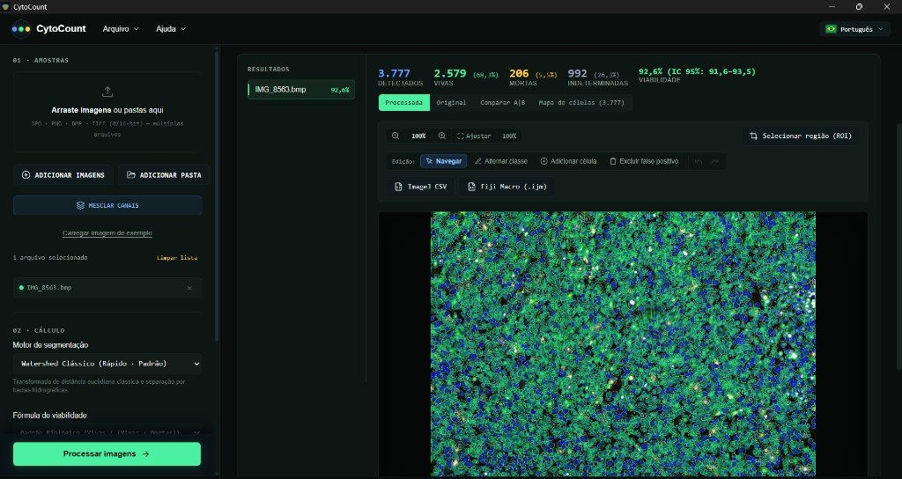

<a name="inicio"></a>
<p align="center">
  <a href="https://github.com/gcandid0/CytoCount">
    
  </a>
</p>

<div align="center">

# CytoCount

### Plataforma científica de escritorio para cuantificación automatizada de viabilidad celular y segmentación morfológica por microscopía de fluorescencia tri-canal.

<sub><a href="./README.md">🇧🇷 Português</a> &nbsp;|&nbsp; <a href="./README.en.md">🇺🇸 English</a> &nbsp;|&nbsp; 🇪🇸 Español</sub>

<br/>

<a href="https://doi.org/10.5281/zenodo.24224692"></a>
<a href="https://gcandid0.github.io/CytoCount"></a>
<a href="https://tauri.app/"></a>
<a href="https://www.python.org/"></a>
<a href="https://react.dev/"></a>
<a href="https://github.com/stardist/stardist"></a>
<a href="./LICENSE"></a>

<br/>

<a href="https://github.com/gcandid0/CytoCount/stargazers"></a>
<a href="https://github.com/gcandid0/CytoCount/commits/main"></a>
<a href="https://github.com/gcandid0/CytoCount"></a>
<a href="https://github.com/gcandid0/CytoCount/issues"></a>

<br/><br/>

<a href="http://lattes.cnpq.br/6696786236047929"></a>
<a href="https://www.linkedin.com/in/gabriel-candido-235637226/"></a>
<a href="https://github.com/gcandid0/CytoCount"></a>

</div>

<p align="center"><sub>Desarrollado por <strong>Gabriel Candido Messias dos Santos</strong> · Campinas - SP, Brasil</sub></p>

## Índice

- [Sobre CytoCount](#sobre-cytocount)
- [Idiomas](#idiomas)
- [Fluoróforos y Canales Soportados](#fluoróforos-y-canales-soportados)
- [Cómo usar](#cómo-usar)
- [Funcionalidades](#funcionalidades)
- [Motores de Segmentación](#motores-de-segmentación)
- [Stack Tecnológico](#stack-tecnológico)
- [Roadmap](#roadmap)
- [Contacto](#contacto)
- [Autores](#autores)
- [Licencia](#licencia)
- [Cómo citar](#cómo-citar)
- [Contribuir](#contribuir)

---

> 🌐 **Sitio de Demostración & Descargas Online:** Visite [**https://gcandid0.github.io/CytoCount**](https://gcandid0.github.io/CytoCount) para explorar demostraciones interactivas en GIFs animados, comparador de cortina y descargas directas para Windows (NSIS .exe, MSI y Portable ZIP).

## Sobre CytoCount

**CytoCount** es un software científico de alto rendimiento diseñado para la **cuantificación automatizada de viabilidad celular** y la **segmentación morfológica de alta precisión** en imágenes de microscopía de fluorescencia tri-canal.

Construido sobre una arquitectura híbrida moderna que combina **Rust (Tauri v2)** para la aplicación de escritorio nativa y **Python (FastAPI, OpenCV, SciPy, scikit-image)** operando como un motor informático local (*sidecar*), CytoCount procesa el 100% de los datos sin conexión a internet, garantizando total confidencialidad para muestras experimentales sensibles.

**Características principales:**

- **Conteo Consistente e IC 95% Wilson** - `Detectados = Vivas + Muertas + Indeterminadas` con cálculo riguroso del intervalo de confianza binomial de Wilson.
- **Motores Híbridos de Segmentación** - permite alternar entre *Watershed Clásico* (cuencas hidrográficas por distancia euclidiana), *StarDist 2D* (polígonos estrella-convexos) y *Cellpose 2D* (flujos de gradiente dinámico).
- **Delimitación Morfológica de Citoplasma** - partición continua mediante diagrama de Voronoi geodésico para medir el área celular sin invadir células vecinas ni alterar la viabilidad nuclear.
- **Curaduría y Edición Manual Interactiva** - herramientas directas en el visor para alternar clases, añadir células omitidas o eliminar falsos positivos, con historial completo `Ctrl+Z` (Deshacer) y `Ctrl+Y` (Rehacer).
- **Fusión Multicanal y TIFF de 16 bits** - soporte para archivos con canales separados (`_DAPI`, `_FITC`, `_PI`) e imágenes científicas multicanal de alto rango dinámico.
- **Exportación para Publicaciones Científicas** - generación a 300 y 600 DPI (PNG, TIFF, PDF, SVG) con barras de escala micrométricas calibradas, paletas accesibles para daltonismo (Okabe-Ito) e interoperabilidad con **ImageJ / Fiji** (macros `.ijm` y tablas `.csv`).

<br>

<div align="center">
  <a href="https://github.com/gcandid0/CytoCount">
    
  </a>
</div>

<p align="right"><a href="#inicio">↑ volver arriba</a></p>

## Idiomas

La plataforma cuenta con soporte trilingüe completo en su interfaz gráfica, informes ejecutivos, figuras generadas y macros de automatización:

🇧🇷 Português &nbsp;|&nbsp; 🇺🇸 English &nbsp;|&nbsp; 🇪🇸 Español

<p align="right"><a href="#inicio">↑ volver arriba</a></p>

## Fluoróforos y Canales Soportados

| Canal de Fluorescencia | Fluoróforos Típicos | Diana Biológica / Función | Identificación Visual |
|---|---|---|---|
| **Canal Azul** | DAPI, Hoechst 33342 | Núcleo celular (ADN total) | Contorno Azul (`#0072B2`) |
| **Canal Verde** | Calceína-AM, FITC, GFP, Alexa 488 | Esterasa citoplasmática activa (Células Vivas) | Contorno Verde (`#00FF00`) |
| **Canal Amarillo / Rojo** | Yoduro de Propidio (PI), EthD-1, Texas Red | Pérdida de integridad de membrana (Células Muertas) | Contorno Amarillo (`#00FFFF`) |
| **Anillo de Citoplasma** | Voronoi Geodésico por expansión | Límite morfológico celular externo | Borde Cian (`#50B4DC`) |

<p align="right"><a href="#inicio">↑ volver arriba</a></p>

## Cómo usar

> [!IMPORTANT]
> El código fuente de este repositorio está disponible para **investigación científica, evaluación y estudio académico**, de acuerdo con los términos de la [licencia](#licencia).

### Ejecutable de Escritorio (Windows)

No es necesario instalar Python ni compilar código para utilizar CytoCount:

1. Descarga el archivo de instalación:
   - **Instalador NSIS**: `CytoCount_1.3.1_x64-setup.exe`
   - **Instalador MSI Empresarial**: `CytoCount_1.3.1_x64_en-US.msi`
   - **Ejecutable Standalone**: `viacell.exe` (ejecución directa sin instalación)
2. Inicia **CytoCount**.
3. Arrastra y suelta imágenes microscópicas (`.png`, `.jpg`, `.bmp`, `.tif`, `.tiff`) o carpetas completas para iniciar el procesamiento automatizado.

---

### Ejecución desde el Código Fuente (Desarrollo)

**Requisitos previos:**
- Node.js 18+ y npm
- Rust 1.77+ y cargo
- Python 3.10+ (se recomienda Python 3.12)

```powershell
# 1. Clona el repositorio
git clone https://github.com/gcandid0/CytoCount.git
cd CytoCount

# 2. Crea y activa el entorno virtual de Python
python -m venv .venv
.\.venv\Scripts\Activate.ps1

# 3. Instala las dependencias científicas
pip install -r backend/requirements.txt

# 4. Instala las dependencias de la interfaz
npm install

# 5. Ejecuta en modo de desarrollo (con recarga en vivo)
npm run tauri dev
```

**Dependencias Principales del Backend** (`backend/requirements.txt`):

| Paquete | Versión | Propósito |
|---|---|---|
| fastapi | 0.115.0 | Microservicio local HTTP/JSON de alto rendimiento |
| uvicorn | 0.30.6 | Servidor ASGI para ejecución asíncrona |
| opencv-python-headless | 4.10.0.84 | Operaciones matriciales, umbralización de Otsu y morfología matemática |
| numpy | 1.26.4 | Operaciones con tensores y álgebra vectorial |
| scipy | 1.13.1 | Transformadas de distancia euclidiana y etiquetado de componentes |
| scikit-image | 0.24.0 | Algoritmo Watershed morfológico y detección de picos |
| Pillow | 10.4.0 | Renderizado tipográfico TrueType para leyendas científicas |
| tifffile | 2024.8.10 | Decodificación de archivos TIFF científicos de 16 bits |

<p align="right"><a href="#inicio">↑ volver arriba</a></p>

---

## Funcionalidades

### Fuente Única de la Verdad e Intervalo de Confianza Wilson (95%)

Garantiza coherencia analítica estricta:
$$\text{Detectados} = \text{Vivas} + \text{Muertas} + \text{Indeterminadas}$$

La viabilidad celular se reporta calculando el intervalo de confianza binomial de Wilson al 95%:
$$\text{Viabilidad} = \frac{\text{Vivas}}{\text{Vivas} + \text{Muertas}} \times 100\% \quad (\text{IC } 95\%: [L_{inf}, L_{sup}])$$

Si la proporción de células indeterminadas supera el 15%, el sistema emite una alerta de calidad automática recomendando revisión de contraste o dilución de la muestra.

### Motores Híbridos de Segmentación

Permite comparar enfoques clásicos y de vanguardia:
1. **Watershed Clásico**: Transformada de distancia euclidiana con supresión de fondo Top-Hat y filtrado bilateral.
2. **StarDist 2D**: Regresión radial estrella-convexa con supresión de no máximos poligonal (NMS).
3. **Cellpose 2D**: Flujos dinámicos de gradiente vectorial para desacoplar colonias confluentes.

### Delimitación Morfológica de Citoplasma

Genera el anillo celular mediante diagrama de Voronoi geodésico a partir de cada núcleo, cuantificando la superficie citoplasmática sin alterar la clasificación de viabilidad celular.

### Curaduría Manual y Reproducibilidad Científica

Permite al investigador inspeccionar y ajustar los resultados directamente:
- Alternar clasificación (`Viva` $\leftrightarrow$ `Muerta` $\leftrightarrow$ `Indeterminada`).
- Añadir células no detectadas con un solo clic.
- Eliminar falsos positivos generados por artefactos de tinción o detritos.
- Historial con `Ctrl+Z` (Deshacer) e `Ctrl+Y` (Rehacer), guardando cada edición en el archivo `.cytoproj` para auditoría y reproducibilidad.

### Integración con ImageJ / Fiji y Exportación de Figuras

- **ImageJ CSV**: Exporta tablas con coordenadas $(X, Y)$, área e intensidad media compatibles con el *Results Table*.
- **Fiji Macro (`.ijm`)**: Genera un script automatizado que registra todos los polígonos celulares directamente en el *ROI Manager* de Fiji.
- **Figuras para Revistas Científicas**: Genera composiciones a 300 o 600 DPI con barras de escala físicas ($\mu\text{m/px}$) en formatos matriciales y vectoriales (PNG, TIFF, PDF, SVG).

<p align="right"><a href="#inicio">↑ volver arriba</a></p>

---

## Stack Tecnológico

- **Frontend Desktop:** React 18, TypeScript, Vite, CSS moderno, Lucide Icons, Canvas API
- **Puente Nativo:** Rust 1.77+, Tauri v2 (IPC asíncrono y aislamiento seguro)
- **Motor Científico:** Python 3.12, FastAPI, OpenCV, SciPy, scikit-image, NumPy, Pillow, tifffile
- **Empaquetado:** PyInstaller (sidecar autónomo sin dependencias externas de Python), WiX Toolset y NSIS

<p align="right"><a href="#inicio">↑ volver arriba</a></p>

---

## Roadmap

- [x] Conteo coherente con intervalo binomial de Wilson (95%)
- [x] Motores integrados de segmentación (Watershed, StarDist 2D, Cellpose 2D)
- [x] Delimitación morfológica de citoplasma (Voronoi)
- [x] Curaduría interactiva en pantalla con Deshacer / Rehacer
- [x] Fusión de canales monocromáticos y soporte TIFF de 16 bits
- [x] Exportación directa a ImageJ / Fiji (.csv e .ijm)
- [x] Figuras científicas de alta resolución a 300/600 DPI
- [x] Soporte multilingüe en tres idiomas (PT / EN / ES)
- [ ] Módulo cinético para ensayos de viabilidad celular *time-lapse*

<p align="right"><a href="#inicio">↑ volver arriba</a></p>

---

## Contacto

Preguntas, sugerencias o reportes de errores pueden enviarse mediante [issues en GitHub](https://github.com/gcandid0/CytoCount/issues) o directamente al correo electrónico del autor.

## Autores

Proyecto desarrollado por:

- **Gabriel Candido Messias dos Santos** — [gabrielcandidomds@gmail.com](mailto:gabrielcandidomds@gmail.com) · [Lattes](http://lattes.cnpq.br/6696786236047929) · [LinkedIn](https://www.linkedin.com/in/gabriel-candido-235637226/)

## Licencia

**CytoCount** está protegido por derechos de autor según la legislación brasileña de software (Ley nº 9.609/1998 y Ley nº 9.610/1998).

- ✅ Se permite el **uso libre para investigación científica, docencia y estudio académico sin fines comerciales**.
- ❌ **No se permite** la explotación comercial, redistribución en código cerrado o apropiación sin la autorización expresa y por escrito del autor.

Consulta el texto completo en [LICENSE](LICENSE).

## Cómo citar

Si utilizas CytoCount en artículos científicos, tesis o congresos, por favor cita la herramienta en uno de los siguientes formatos:

<details>
<summary><strong>ABNT</strong></summary>

```
SANTOS, Gabriel Candido Messias dos. CytoCount: Automated Fluorescence Cell
Viability Counter and Morphological Segmenter. Versão 1.3.1. Campinas, 2026.
DOI: 10.5281/zenodo.24224692. Disponível em: https://github.com/gcandid0/CytoCount.
```
</details>

<details>
<summary><strong>APA</strong></summary>

```
Santos, G. C. M. (2026). CytoCount: Automated fluorescence cell viability
counter and morphological segmenter (Versión 1.3.1) [Software de computación].
Campinas, SP, Brasil. https://doi.org/10.5281/zenodo.24224692
```
</details>

<details>
<summary><strong>Vancouver</strong></summary>

```
Santos GCM. CytoCount: automated fluorescence cell viability counter and
morphological segmenter [Internet]. Versión 1.3.1. Campinas; 2026. Disponible en:
https://doi.org/10.5281/zenodo.24224692
```
</details>

<details>
<summary><strong>IEEE</strong></summary>

```
G. C. M. Santos, "CytoCount: Automated Fluorescence Cell Viability Counter and
Morphological Segmenter," Versión 1.3.1, Campinas, Brasil, 2026. doi:
10.5281/zenodo.24224692. [En línea]. Disponible: https://github.com/gcandid0/CytoCount
```
</details>

<details>
<summary><strong>BibTeX</strong></summary>

```bibtex
@software{santos_cytocount_2026,
  author       = {Santos, Gabriel Candido Messias dos},
  title        = {{CytoCount: Automated Fluorescence Cell Viability Counter and Morphological Segmenter}},
  version      = {1.3.1},
  year         = {2026},
  address      = {Campinas, SP, Brasil},
  doi          = {10.5281/zenodo.24224692},
  url          = {https://doi.org/10.5281/zenodo.24224692}
}
```
</details>

<details>
<summary><strong>RIS</strong> (Zotero, Mendeley, EndNote)</summary>

```
TY  - COMP
AU  - Santos, Gabriel Candido Messias dos
TI  - CytoCount: Automated Fluorescence Cell Viability Counter and Morphological Segmenter
ET  - 1.3.1
PY  - 2026
CY  - Campinas, SP, Brasil
DO  - 10.5281/zenodo.24224692
UR  - https://doi.org/10.5281/zenodo.24224692
ER  -
```
</details>

## Contribuir

Las contribuciones son bienvenidas, respetando los términos de la [licencia](#licencia). Consulta la guía completa en [CONTRIBUTING.md](CONTRIBUTING.md).

<p align="right"><a href="#inicio">↑ volver arriba</a></p>

---

> [!WARNING]
> CytoCount está diseñado para fines de investigación científica; los resultados deben ser validados por el investigador antes de tomar decisiones médicas, farmacológicas o clínicas.

<br>

<div align="center">
  
  <br>
  <sub>
    <strong>CytoCount</strong> · por Gabriel Candido Messias dos Santos<br>
    <a href="https://github.com/gcandid0/CytoCount">Repositorio en GitHub</a> ·
    <a href="http://lattes.cnpq.br/6696786236047929">Currículum Lattes</a> ·
    <a href="https://www.linkedin.com/in/gabriel-candido-235637226/">LinkedIn</a> ·
    <a href="mailto:gabrielcandidomds@gmail.com">Contacto del Autor</a>
  </sub>
</div>
