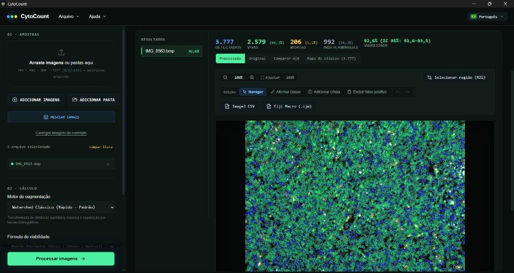

<a name="topo"></a>
<p align="center">
  <a href="https://github.com/gcandid0/CytoCount">
    
  </a>
</p>

<div align="center">

# CytoCount

### Plataforma científica desktop para quantificação automatizada de viabilidade celular e segmentação morfológica por microscopia de fluorescência tri-canal.

<sub>🇧🇷 Português &nbsp;|&nbsp; <a href="./README.en.md">🇺🇸 English</a> &nbsp;|&nbsp; <a href="./README.es.md">🇪🇸 Español</a></sub>

<br/>

<a href="https://doi.org/10.5281/zenodo.24224692"></a>
<a href="https://tauri.app/"></a>
<a href="https://www.python.org/"></a>
<a href="https://react.dev/"></a>
<a href="https://github.com/stardist/stardist"></a>
<a href="./LICENSE"></a>

<br/>

<a href="https://github.com/gcandid0/CytoCount/stargazers"></a>
<a href="https://github.com/gcandid0/CytoCount/commits/main"></a>
<a href="https://github.com/gcandid0/CytoCount"></a>
<a href="https://github.com/gcandid0/CytoCount/issues"></a>

<br/><br/>

<a href="http://lattes.cnpq.br/6696786236047929"></a>
<a href="https://www.linkedin.com/in/gabriel-candido-235637226/"></a>
<a href="https://github.com/gcandid0/CytoCount"></a>

</div>

<p align="center"><sub>Desenvolvido por <strong>Gabriel Candido Messias dos Santos</strong> · Campinas - SP, Brasil</sub></p>

## Índice

- [Sobre o CytoCount](#sobre-o-cytocount)
- [Idiomas](#idiomas)
- [Fluoróforos e Canais Suportados](#fluoróforos-e-canais-suportados)
- [Como usar](#como-usar)
- [Funcionalidades](#funcionalidades)
- [Motores de Segmentação](#motores-de-segmentação)
- [Stack Tecnológica](#stack-tecnológica)
- [Roadmap](#roadmap)
- [Contato](#contato)
- [Autores](#autores)
- [Licença](#licença)
- [Como citar](#como-citar)
- [Contribuindo](#contribuindo)

---

## Sobre o CytoCount

O **CytoCount** é um software científico de alto desempenho projetado para a **quantificação automatizada de viabilidade celular** e **segmentação morfológica de alta precisão** em imagens de microscopia de fluorescência tri-canal.

Construído sob uma arquitetura híbrida moderna que combina **Rust (Tauri v2)** para o cliente desktop nativo e **Python (FastAPI, OpenCV, SciPy, scikit-image)** operando como *sidecar* computacional local, o CytoCount oferece processamento 100% offline, garantindo total privacidade para dados e amostras laboratoriais confidenciais.

**Principais recursos:**

- **Contagem Consistente & IC 95% Wilson** - `Detectados = Vivas + Mortas + Indeterminadas` com cálculo de intervalo de confiança estatístico binomial.
- **Motores Híbridos de Segmentação** - flexibilidade para alternar entre *Watershed Clássico* (bacias hidrográficas por distância euclidiana), *StarDist 2D* (polígonos estrelados convexos) e *Cellpose 2D* (fluxos dinâmicos celulares).
- **Delimitação Morfológica de Citoplasma** - partição contínua via diagrama de Voronoi geodésico para quantificação de área celular sem invadir células vizinhas.
- **Curadoria e Edição Manual Interativa** - ferramentas no visualizador para alternar classes, adicionar células perdidas ou remover falsos positivos, com suporte a `Ctrl+Z` (Desfazer) e `Ctrl+Y` (Refazer).
- **Mesclagem Multicanal & TIFF 16-bit** - suporte a arquivos com canais separados (`_DAPI`, `_FITC`, `_PI`) e imagens monocromáticas/multicanais de alta profundidade dinâmica.
- **Exportação Científica para Publicação** - renderização em 300 e 600 DPI (PNG, TIFF, PDF, SVG) com barras de escala micrométricas calibradas, metadados físicos, paletas acessíveis para daltonismo (Okabe-Ito) e interoperabilidade com **ImageJ / Fiji** (macros `.ijm` e tabelas `.csv`).

<br>

<div align="center">
  <a href="https://github.com/gcandid0/CytoCount">
    
  </a>
</div>

<p align="right"><a href="#topo">↑ voltar ao topo</a></p>

## Idiomas

A plataforma oferece internacionalização completa (interface gráfica, relatórios executivos, figuras exportadas e macros), disponível em três idiomas selecionáveis diretamente no cabeçalho:

🇧🇷 Português &nbsp;|&nbsp; 🇺🇸 English &nbsp;|&nbsp; 🇪🇸 Español

<p align="right"><a href="#topo">↑ voltar ao topo</a></p>

## Fluoróforos e Canais Suportados

| Canal de Fluorescência | Fluoróforos Típicos | Alvo Biológico / Função | Identificação Visual |
|---|---|---|---|
| **Canal Azul** | DAPI, Hoechst 33342 | Núcleo celular (DNA total) | Contorno Azul (`#0072B2`) |
| **Canal Verde** | Calceína-AM, FITC, GFP, Alexa 488 | Esterase citoplasmática ativa (Células Vivas) | Contorno Verde (`#00FF00`) |
| **Canal Amarelo / Vermelho** | Iodeto de Propídio (PI), EthD-1, Texas Red | Ruptura de membrana plasmática (Células Mortas) | Contorno Amarelo (`#00FFFF`) |
| **Anel de Citoplasma** | Voronoi Geodésico restrito por expansão | Delimitação da borda celular morfológica | Borda Ciano (`#50B4DC`) |

<p align="right"><a href="#topo">↑ voltar ao topo</a></p>

## Como usar

> [!IMPORTANT]
> O código-fonte está disponível neste repositório para **pesquisa científica, avaliação e estudo acadêmico**, conforme os termos da [licença](#licença).

### Executável Desktop (Windows)

Não é necessário compilar código para utilizar a aplicação em estações de trabalho:

1. Baixe o instalador mais recente:
   - **Instalador NSIS**: `CytoCount_1.1.0_x64-setup.exe`
   - **Instalador MSI Corporativo**: `CytoCount_1.1.0_x64_en-US.msi`
   - **Executável Portátil Standalone**: `viacell.exe` (execução direta sem instalação)
2. Execute o instalador e abra o **CytoCount**.
3. Arraste imagens (`.png`, `.jpg`, `.bmp`, `.tif`, `.tiff`) ou pastas completas para iniciar as análises automatizadas.

---

### Execução a partir do Código-Fonte (Desenvolvimento)

**Pré-requisitos:**
- Node.js 18+ e npm
- Rust 1.77+ e cargo
- Python 3.10+ (recomendado Python 3.12)

```powershell
# 1. Clone o repositório
git clone https://github.com/gcandid0/CytoCount.git
cd CytoCount

# 2. Crie e ative o ambiente virtual Python
python -m venv .venv
.\.venv\Scripts\Activate.ps1

# 3. Instale as dependências científicas
pip install -r backend/requirements.txt

# 4. Instale as dependências da interface web
npm install

# 5. Execute em modo de desenvolvimento (Hot-Reloading)
npm run tauri dev
```

**Dependências Principais do Backend** (`backend/requirements.txt`):

| Pacote | Versão | Função Principal |
|---|---|---|
| fastapi | 0.115.0 | Servidor de microserviço HTTP/JSON para o sidecar |
| uvicorn | 0.30.6 | Motor ASGI assíncrono de alto rendimento |
| opencv-python-headless | 4.10.0.84 | Processamento matricial, limiares de Otsu e morfologia |
| numpy | 1.26.4 | Operações tensoriais e álgebra vetorial |
| scipy | 1.13.1 | Transformadas de distância euclidiana e rotulagem conectada |
| scikit-image | 0.24.0 | Segmentação Watershed morfológica e filtros de pico |
| Pillow | 10.4.0 | Renderização tipográfica de legendas TrueType para publicação |
| tifffile | 2024.8.10 | Leitura e decodificação de pilhas TIFF científicas de 16 bits |

<p align="right"><a href="#topo">↑ voltar ao topo</a></p>

---

## Funcionalidades

### Fonte Única da Verdade & Intervalo de Confiança Wilson (95%)

Garante rigor metodológico absoluto:
$$\text{Detectados} = \text{Vivas} + \text{Mortas} + \text{Indeterminadas}$$

A viabilidade é calculada segundo a fórmula biológica padrão ou sobre o total de detectados, acompanhada do intervalo de confiança binomial de Wilson (95%):
$$\text{Viabilidade} = \frac{\text{Vivas}}{\text{Vivas} + \text{Mortas}} \times 100\% \quad (\text{IC } 95\%: [L_{inf}, L_{sup}])$$

Caso a amostra apresente mais de 15% de células indeterminadas (baixo contraste, ruído excessivo ou aglomeração extrema), o sistema emite um alerta de qualidade automático para revisão metodológica.

### Motores de Segmentação Híbridos

Permite comparar visualmente o resultado entre abordagens consolidadas e modernas de bioimagem:
1. **Watershed Clássico**: Separação euclidiana por bacias hidrográficas com correção de fundo Top-Hat e filtragem bilateral.
2. **StarDist 2D**: Formulação centro-radial estrela-convexa com supressão de não-máximos poligonal (NMS).
3. **Cellpose 2D**: Campo vetorial topológico de difusão de gradiente com convergência de pontos fixos para desaglomeração de colônias confluentes.

### Delimitação Morfológica do Citoplasma

Gera o anel celular via particionamento Voronoi restrito a partir de cada semente nuclear, quantificando com exatidão a área citoplasmática e os limites externos sem que o citoplasma interfira na classificação de viabilidade nuclear.

### Curadoria Manual e Auditoria Científica

Permite ao pesquisador refinar os resultados diretamente na tela:
- Alternar classe celular (`Viva` $\leftrightarrow$ `Morta` $\leftrightarrow$ `Indeterminada`).
- Adicionar célula perdida por clique simples.
- Excluir falsos positivos causados por debris ou artefatos de fixação.
- Histórico completo com `Ctrl+Z` (Desfazer) e `Ctrl+Y` (Refazer), gravando todas as edições no arquivo de projeto `.cytoproj` para reprodutibilidade científica.

### Exportação para ImageJ / Fiji e Publicação

- **ImageJ CSV**: Exporta a tabela com centróides $(X, Y)$, área em pixels e intensidade média compatível com o *Results Table*.
- **Fiji Macro (`.ijm`)**: Gera script de automação que desenha e cadastra todos os polígonos celulares diretamente no *ROI Manager* do Fiji.
- **Figuras Prontas para Publicação**: Gera composições com escala micrométrica calibrada ($\mu\text{m/px}$), resolução de 300 ou 600 DPI em formatos vetoriais e matriciais (PNG, TIFF, PDF, SVG).

<p align="right"><a href="#topo">↑ voltar ao topo</a></p>

---

## Stack Tecnológica

- **Frontend Desktop:** React 18, TypeScript, Vite, CSS moderno, Lucide Icons, Canvas API
- **Camada Nativa:** Rust 1.77+, Tauri v2 (IPC assíncrono e segurança de sandbox)
- **Motor Científico:** Python 3.12, FastAPI, OpenCV, SciPy, scikit-image, NumPy, Pillow, tifffile
- **Empacotamento:** PyInstaller (sidecar independente sem dependência de Python no sistema host) e WiX Toolset / NSIS

<p align="right"><a href="#topo">↑ voltar ao topo</a></p>

---

## Roadmap

- [x] Contagem consistente com modelo binomial de Wilson (95%)
- [x] Motores de segmentação integrados (Watershed, StarDist 2D e Cellpose 2D)
- [x] Delimitação morfológica de citoplasma (anel Voronoi)
- [x] Curadoria interativa na tela com histórico Desfazer / Refazer
- [x] Mesclagem de canais monocromáticos e suporte a TIFF 16-bit
- [x] Exportação para ImageJ / Fiji (.csv e .ijm)
- [x] Geração de figuras para periódicos em 300/600 DPI
- [x] Internacionalização completa em três idiomas (PT / EN / ES)
- [ ] Módulo de análise temporal de viabilidade celular em ensaios *time-lapse*

<p align="right"><a href="#topo">↑ voltar ao topo</a></p>

---

## Contato

Dúvidas, sugestões de aprimoramento ou relatos de inconsistências podem ser enviados através de [issues no GitHub](https://github.com/gcandid0/CytoCount/issues) ou diretamente para os contatos dos desenvolvedores.

## Autores

Projeto desenvolvido por:

- **Gabriel Candido Messias dos Santos** — [gabrielcandidomds@gmail.com](mailto:gabrielcandidomds@gmail.com) · [Lattes](http://lattes.cnpq.br/6696786236047929) · [LinkedIn](https://www.linkedin.com/in/gabriel-candido-235637226/)

## Licença

O **CytoCount** é protegido por direitos autorais sob a legislação brasileira de software (Lei nº 9.609/1998 e Lei nº 9.610/1998).

- ✅ É livre para **pesquisa científica, ensino e uso acadêmico sem fins comerciais**.
- ❌ **Não é permitida** a reprodução comercial, redistribuição fechada ou apropriação de código sem expressa autorização por escrito do autor.

Consulte o documento completo em [LICENSE](LICENSE).

## Como citar

Caso o CytoCount seja utilizado na geração de dados para artigos, dissertações ou teses, por favor cite a ferramenta em um dos formatos abaixo:

<details>
<summary><strong>ABNT</strong></summary>

```
SANTOS, Gabriel Candido Messias dos. CytoCount: Automated Fluorescence Cell
Viability Counter and Morphological Segmenter. Versão 1.1.0. Campinas, 2026.
DOI: 10.5281/zenodo.24224692. Disponível em: https://github.com/gcandid0/CytoCount.
```
</details>

<details>
<summary><strong>APA</strong></summary>

```
Santos, G. C. M. (2026). CytoCount: Automated fluorescence cell viability
counter and morphological segmenter (Version 1.1.0) [Computer software].
Campinas, SP, Brazil. https://doi.org/10.5281/zenodo.24224692
```
</details>

<details>
<summary><strong>Vancouver</strong></summary>

```
Santos GCM. CytoCount: automated fluorescence cell viability counter and
morphological segmenter [Internet]. Version 1.1.0. Campinas; 2026. Available from:
https://doi.org/10.5281/zenodo.24224692
```
</details>

<details>
<summary><strong>IEEE</strong></summary>

```
G. C. M. Santos, "CytoCount: Automated Fluorescence Cell Viability Counter and
Morphological Segmenter," Version 1.1.0, Campinas, Brazil, 2026. doi:
10.5281/zenodo.24224692. [Online]. Available: https://github.com/gcandid0/CytoCount
```
</details>

<details>
<summary><strong>BibTeX</strong></summary>

```bibtex
@software{santos_cytocount_2026,
  author       = {Santos, Gabriel Candido Messias dos},
  title        = {{CytoCount: Automated Fluorescence Cell Viability Counter and Morphological Segmenter}},
  version      = {1.1.0},
  year         = {2026},
  address      = {Campinas, SP, Brasil},
  doi          = {10.5281/zenodo.24224692},
  url          = {https://doi.org/10.5281/zenodo.24224692}
}
```
</details>

<details>
<summary><strong>RIS</strong> (Zotero, Mendeley, EndNote)</summary>

```
TY  - COMP
AU  - Santos, Gabriel Candido Messias dos
TI  - CytoCount: Automated Fluorescence Cell Viability Counter and Morphological Segmenter
ET  - 1.1.0
PY  - 2026
CY  - Campinas, SP, Brasil
DO  - 10.5281/zenodo.24224692
UR  - https://doi.org/10.5281/zenodo.24224692
ER  -
```
</details>

## Contribuindo

Contribuições da comunidade científica são muito bem-vindas. Antes de submeter *Pull Requests* de grande porte, abra uma *Issue* para alinhar arquitetura e validações estatísticas. Consulte [CONTRIBUTING.md](CONTRIBUTING.md).

<p align="right"><a href="#topo">↑ voltar ao topo</a></p>

---

> [!WARNING]
> O CytoCount é um software científico de auxílio analítico. Os dados gerados devem ser validados pelo pesquisador responsável antes de decisões terapêuticas, farmacológicas ou de diagnóstico clínico.

<br>

<div align="center">
  
  <br>
  <sub>
    <strong>CytoCount</strong> · por Gabriel Candido Messias dos Santos<br>
    <a href="https://github.com/gcandid0/CytoCount">Repositório GitHub</a> ·
    <a href="http://lattes.cnpq.br/6696786236047929">Currículo Lattes</a> ·
    <a href="https://www.linkedin.com/in/gabriel-candido-235637226/">LinkedIn</a> ·
    <a href="mailto:gabrielcandidomds@gmail.com">Contato do Autor</a>
  </sub>
</div>
